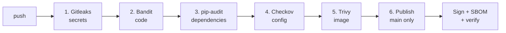

# Secure CI/CD Pipeline

A GitHub Actions pipeline that stops insecure code from shipping. Every push runs through sequential security gates. If any gate fails, everything after it is skipped and nothing is published. Images that pass are published to GitHub Container Registry, **signed with Sigstore**, and shipped with a **signed SBOM**.

## How it works



| Gate | Tool | What it blocks |
|---|---|---|
| 1 | **Gitleaks** | Secrets committed anywhere in git history |
| 2 | **Bandit** | Insecure Python patterns (MEDIUM+ severity), e.g. shell injection |
| 3 | **pip-audit** | Python dependencies with known CVEs |
| 4 | **Checkov** | Misconfigurations in the Dockerfile and the workflow itself |
| 5 | **Trivy** | HIGH/CRITICAL vulnerabilities with an available fix, inside the built image |
| 6 | **Publish** | Pushes to GHCR, only on a push to `main` |

After publishing, the pipeline:

1. Generates a **CycloneDX SBOM** (a list of every package in the image) with Trivy
2. **Signs the image** with Cosign using keyless signing (GitHub OIDC → Sigstore Fulcio certificate, recorded in the Rekor transparency log)
3. Attaches the SBOM as a **signed attestation**
4. **Verifies** both, requiring the signer to be exactly this workflow, on `main`, in this repo

A weekly scheduled run re-scans everything, since new CVEs can make unchanged code fail.

## Design decisions

- **Scan and publish happen in one job.** The image Trivy scans is the exact image that gets pushed. Separate jobs would rebuild, shipping an image that was never scanned.
- **Sign the digest, never a tag.** Tags can be moved to point at different images; a `sha256` digest identifies exact bytes.
- **Keyless signing.** No long-lived private key exists to store, rotate, or leak.
- **Least privilege.** The workflow token is read-only by default. Only the final job gets `packages: write` and `id-token: write`.
- **No stored registry credentials.** Publishing uses the short-lived `GITHUB_TOKEN` generated per run.
- **Gates trust exit codes.** No gate decides pass/fail by searching tool output for strings like "CRITICAL", which can silently stop matching.
- **Pinned actions.** Third-party actions are pinned to exact versions. `trivy-action` tags were targeted in a 2026 supply-chain attack, so floating refs like `@master` are not safe in a security pipeline.
- **Hardened container.** Slim base image, non-root user, `HEALTHCHECK`, production server (gunicorn), and a `.dockerignore` that keeps `.git` and `.env` out of the image.

## Known trade-offs

- **`ignore-unfixed: true` in Trivy.** Vulnerabilities with no available fix don't fail the build; otherwise unfixable base-image CVEs would block every release. The weekly scan surfaces them once a fix ships.
- **Bandit runs at MEDIUM+ severity** to keep LOW-severity noise from blocking builds.

## Verifying the gates actually work

A gate that never fails might be broken, so each gate was tested on a branch with a deliberately planted problem:

| Gate | Test branch | Planted problem | Result |
|---|---|---|---|
| Bandit | `test-bandit-fail` | `subprocess.call(user_input, shell=True)` | Blocked (B602, High) |
| pip-audit | `test-pip-audit-fail` | `flask==2.2.0` | <!-- TODO: fill in --> |
| Gitleaks | `test-gitleaks-fail` | Fake `api_key` in `config.py` | <!-- TODO: fill in --> |

## Verify the image yourself

Requires [cosign](https://docs.sigstore.dev/cosign/system_config/installation/). Use the image digest from the latest run's "Get image digest" step:

```bash
cosign verify \
  --certificate-identity "https://github.com/TanviMurkonda/secure-cicd-pipeline/.github/workflows/pipeline.yml@refs/heads/main" \
  --certificate-oidc-issuer "https://token.actions.githubusercontent.com" \
  ghcr.io/tanvimurkonda/secure-cicd-pipeline@sha256:<digest>
```

A signature from any other workflow, branch, or repo fails this check.

## Run the app locally

```bash
docker build -t secure-cicd-pipeline .
docker run -p 8000:8000 secure-cicd-pipeline
curl http://localhost:8000/health
```

## Roadmap

- Deploy to AWS ECR with Terraform and OIDC-federated IAM roles (no long-lived AWS keys)
- Pin all actions by commit SHA instead of version tag
- Vulnerability policy engine: allowlist accepted findings with a written reason and an expiry date

## Stack

GitHub Actions · Docker · Python/Flask · Gitleaks · Bandit · pip-audit · Checkov · Trivy · Cosign/Sigstore · CycloneDX
